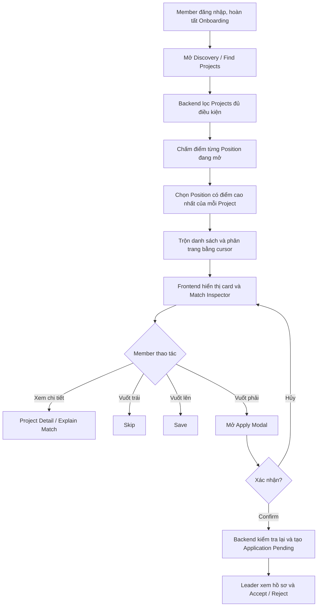
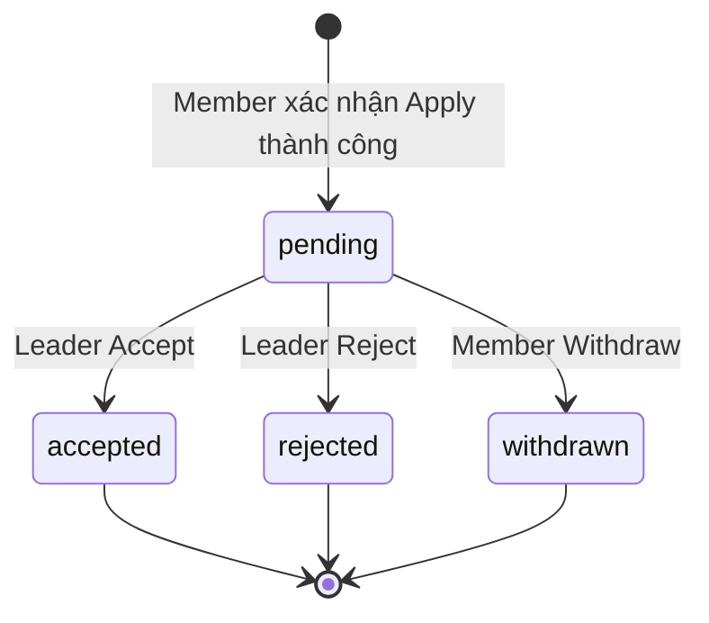
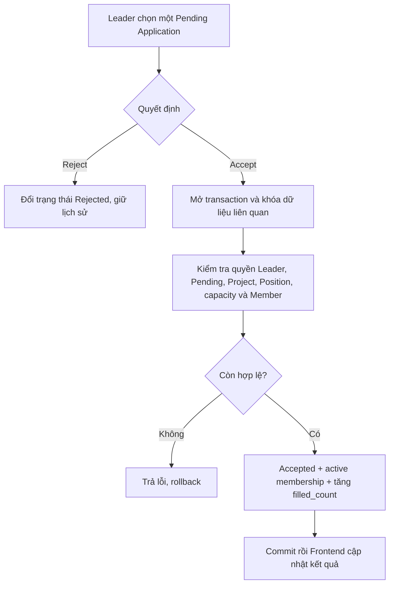

# Tindy — Flow hoạt động Discovery Project

Tài liệu mô tả hành vi đã triển khai trong Backend và Frontend hiện tại, phục vụ team đọc luồng và kiểm thử. Discovery, Matching và Explain Match dùng quy tắc `rule-v1`, không gọi AI.

## 1. Tổng quan



**Find Projects** lấy dữ liệu thật từ Backend. **Find Teammates** hiện vẫn là luồng demo dùng mock data, không đại diện cho chức năng tìm ứng viên thật.

## 2. Dữ liệu đầu vào

| Nguồn | Dữ liệu sử dụng |
| --- | --- |
| Member profile | Skills theo catalog ID, preferred role, số giờ rảnh mỗi tuần |
| Project | Trạng thái, deadline tuyển dụng, capacity, thành viên active, số giờ mong đợi, ngày tạo |
| Position | Role, required/optional skills, trạng thái, tổng slots và slots đã dùng |
| Tương tác | Skip, Save, Application Pending và membership của chính Member |

Tên skill chỉ dùng để hiển thị; so khớp skills/role bằng ID. Experience level, Experiences và Certificates có thể được xem khi đánh giá hồ sơ nhưng không cộng điểm Match.

## 3. Project nào được xuất hiện?

Backend chỉ đưa vào feed Projects thỏa **tất cả** điều kiện sau:

1. Trạng thái `recruiting`, chưa archive.
2. Chưa tới thời điểm đóng tuyển dụng.
3. Người đang xem không phải Leader của Project đó.
4. Người đang xem chưa là thành viên active của Project đó.
5. Người đang xem không có Application `pending` trong Project đó.
6. Số thành viên active nhỏ hơn `max_team_capacity`.
7. Còn ít nhất một Position `open` với `filled_count < required_count`.
8. Người đang xem chưa Skip Project đó.
9. Phù hợp các bộ lọc đã chọn: category, role, skill.

Nếu chọn cả role và skill, cần có một Position đang mở thỏa cả hai bộ lọc. Bộ lọc quyết định Project có nằm trong tập ứng viên; bước chọn best Position vẫn xét các Positions đang mở của Project.

Save không tự loại Project khỏi feed ở Backend. Frontend chuyển sang card tiếp theo sau Save thành công; Project đủ điều kiện có thể xuất hiện lại sau Refresh. Trạng thái Saved vẫn được giữ.

Leader vẫn có thể tìm và Apply vào Project của Leader khác. Chỉ Project do chính người đó dẫn dắt bị loại.

### Deadline

Frontend hỗ trợ 7/14/30 ngày và Custom Date. Ngày đóng tuyển dụng hiểu theo múi giờ Việt Nam (`Asia/Ho_Chi_Minh`); với ngày chọn mới, Backend lưu cutoff là đầu ngày kế tiếp theo giờ Việt Nam, quy đổi sang UTC. Tới cutoff thì ngừng nhận Application mới.

## 4. Backend tính Match như thế nào?

Backend chấm điểm **từng Position đang mở và còn slots**, sau đó chọn Position có điểm cao nhất cho card Project. Nếu bằng điểm, dùng Position ID để giữ thứ tự ổn định.

| Tiêu chí | Trọng số gốc | Cách tính factor |
| --- | ---: | --- |
| Required skills | 40% | Số required skills Member có / tổng required skills của Position |
| Preferred role | 30% | Cùng role ID: 1; khác hoặc chưa chọn preferred role: 0 |
| Availability | 20% | `min(1, giờ rảnh của Member / giờ Project mong đợi)` |
| Optional skills | 10% | Số optional skills Member có / tổng optional skills của Position |

Nếu Position không khai báo required/optional skills thì tiêu chí tương ứng bị loại khỏi phép tính. Nếu thiếu availability hoặc giờ mong đợi không hợp lệ thì availability là Unknown và bị loại. Trọng số của các tiêu chí còn lại được chuẩn hóa về tổng 100%.

```text
normalized_weight = original_weight / tổng trọng số các tiêu chí có factor × 100
contribution = factor × normalized_weight
match_score = làm tròn tổng contribution thành số nguyên, giới hạn 0..100
```

Làm tròn điểm tổng theo AwayFromZero. Ví dụ: đủ required skills, đúng preferred role, đủ optional skills nhưng chỉ có 5 giờ/tuần so với mong đợi 10 giờ → `40 + 30 + 10 + 10 = 90` điểm.

**Chi tiết hành vi hiện tại:** thiếu preferred role vẫn có factor 0 cho tiêu chí role; không bị loại như availability Unknown. Backend gắn `data_incomplete` khi thiếu preferred role, thiếu availability hoặc Member chưa có skills. Vì vậy không nên diễn giải mọi dữ liệu thiếu đều được loại khỏi điểm.

### Explain Match

Frontend hiển thị điểm và breakdown Backend trả về: best Position, từng factor, trọng số, điểm đóng góp, skills khớp/còn thiếu và explanation. Frontend không tự tính lại điểm tổng, không sinh giải thích bằng AI và không điền điểm giả khi API lỗi.

Popup đầy đủ và Match Inspector ở Discovery/Project Detail dùng cùng dữ liệu. Khi mở Project Detail từ feed, match được truyền kèm theo tài khoản đang xem. Mở trực tiếp Detail mà không có match thì giao diện dẫn về Discovery, không tự tạo một điểm thay thế.

## 5. Sắp xếp và tải thêm

- Frontend yêu cầu mỗi trang 20 Projects; Backend giới hạn `limit` trong khoảng 1–50.
- Backend trộn từng nhóm theo tỷ lệ khoảng 60% best match, 25% Projects mới và 15% khám phá; với trang 20 là 12/5/3 khi đủ dữ liệu. Nhóm khám phá lấy mẫu từ nửa dưới của phần danh sách còn lại, không đặt ngưỡng điểm loại cứng.
- Một Project chỉ có một card trong snapshot. Không phải toàn bộ danh sách đều sắp điểm giảm dần vì có nhóm mới và khám phá.
- `Load more` dùng cursor của Backend, không tự tăng trang trên một danh sách mock và không giới hạn tổng feed ở 50 Projects.
- Snapshot giữ thứ tự trong phiên; những trang sau kiểm tra lại điều kiện hiện tại và bỏ card đã hết hạn, hết điều kiện hoặc bị Skip. Thông tin slots/capacity/deadline/Saved được cập nhật, còn điểm không được tính lại toàn bộ trên từng trang.
- Refresh tạo snapshot mới. Sau thay đổi profile hoặc muốn thấy Project mới, Refresh để nhận danh sách và điểm tính lại. Đổi bộ lọc cũng tải lại từ đầu với cursor mới.

## 6. Hành vi từng thao tác

| Thao tác | Kết quả |
| --- | --- |
| Vuốt trái / Skip | Ghi Skip trên Backend; chỉ chuyển card sau thành công |
| Vuốt lên / Save | Lưu Saved trên Backend; chỉ chuyển card sau thành công |
| Vuốt phải / Apply | Chỉ mở Apply Modal, chưa tạo Application |
| Cancel Apply | Đóng modal, không gửi Application POST |
| Confirm Apply | Chọn Position, gửi Application; chờ Backend xác nhận |
| Why this matches / Details | Mở giải thích Rule-Based |
| Inspect project / Full Specs | Mở Project Detail thật |
| Undo | Hoàn tác Skip/Save gần nhất qua Backend; Save phục hồi trạng thái trước đó |

Undo không rút Application. Rút đơn dùng Withdraw trong Applications. Các thao tác đều gắn với tài khoản đăng nhập; trạng thái của người này không được áp sang người khác.

Khi API báo lỗi, giữ thông báo lỗi và cho xử lý lại phù hợp; không chuyển sang mock Projects hoặc báo thành công giả. Khi gửi Application mà mất phản hồi, Frontend đối chiếu lịch sử để tìm kết quả đã commit và tránh POST lại mù quáng. Nếu chưa xác định được kết quả thì không khẳng định thành công và không tự gửi lại vô điều kiện. Backend hiện chưa có hợp đồng idempotency key cho Application.

## 7. Application và Apply lại



- Mỗi Member chỉ có **một Application Pending trong cùng Project**, kể cả chọn Position khác.
- Tạo Pending chưa thêm Member vào team và chưa chiếm slot của Position.
- Rejected/Withdrawn cho phép Apply lại ngay, kể cả cùng Position; không có cooldown.
- Mỗi lần Apply lại tạo Application ID mới; đơn cũ vẫn nằm trong lịch sử. Sơ đồ trên thể hiện vòng đời một đơn, không chuyển đơn cũ từ Rejected/Withdrawn về Pending.
- Apply lại vẫn cần Project còn tuyển, chưa tới deadline, còn capacity/Position và Member chưa active trong Project.
- Backend kiểm tra lại các điều kiện khi nhận Apply; card đã tải trước đó không bảo đảm Position còn trống tại lúc xác nhận.

## 8. Leader xét duyệt

Leader mở Applications của Project mình dẫn dắt, xem đúng Position mà Member đã Apply, Match của Position đó, Profile, Experiences và Certificates. Điểm này có thể khác best-position score trên card Discovery.



Accept dùng transaction và khóa theo thứ tự Project → Position → Application để chống overbooking khi nhiều request đồng thời. Nếu Position đã đầy hoặc team đủ người thì request tiếp theo bị từ chối; không thêm thành viên cục bộ để giả lập thành công. Position được chuyển filled khi đủ slots.

Application Pending đã nộp trước cutoff có thể được Accept sau cutoff nếu Project vẫn recruiting, chưa archive và các điều kiện còn lại hợp lệ. Deadline chặn đơn mới; không tự động Reject những đơn đã Pending.

## 9. Kịch bản demo cho team

1. Seed theo [SEED_DEMO_QUICKSTART.md](SEED_DEMO_QUICKSTART.md).
2. Đăng nhập `demo20`, mở Find Projects, xem card, điểm và Explain Match.
3. Thử Skip → Undo; Save → xem Saved.
4. Chọn Project của `demo01` hoặc `demo02`, vuốt phải rồi Cancel: chưa có Application.
5. Apply lần nữa và Confirm: có Pending, Project bị loại khỏi feed đủ điều kiện.
6. Đăng nhập đúng Leader, xem hồ sơ và Reject đơn.
7. Quay lại Member, Apply lại ngay vào cùng Position: có đơn mới, đơn Rejected vẫn còn.
8. Thử Withdraw rồi Apply lại tương tự.
9. Leader Accept đơn mới: Member xuất hiện trong team, slots cập nhật và không thể Apply lại khi đang active.

## 10. Nguồn đối chiếu trong source

- Backend: `DiscoveryEligibility.cs`, `DiscoveryRepository.cs`, `DiscoveryService.cs`, `DiscoveryFeedSessions.cs`, `PositionMatchScorer.cs`, `RecruitmentDeadline.cs`, `ProjectApplicationService.cs`, `ProjectApplicationRepository.cs`.
- Frontend: `LiveDiscoveryView.tsx`, `SwipeDiscoveryView.tsx`, `SwipeCardStack.tsx`, `ApplyModal.tsx`, `RuleMatchPanel.tsx`, `ProjectDetailScreen.tsx`, các services/hooks Discovery và Applications.

Đây là tài liệu flow dựa trên source; việc tạo tài liệu không thực hiện seed, không ghi Application và không thay đổi schema/database.
