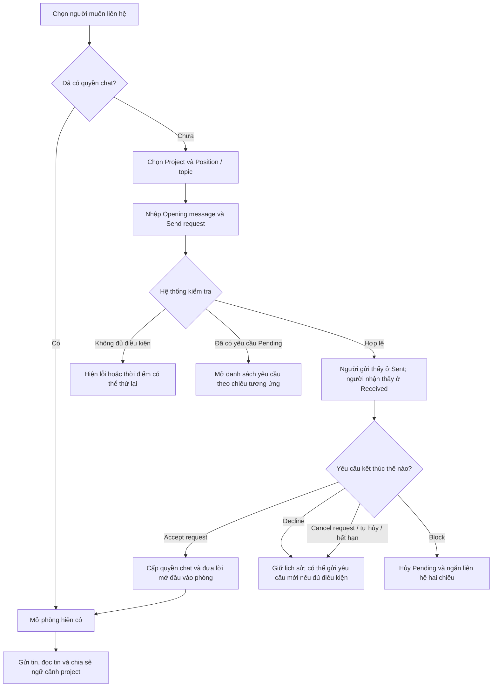
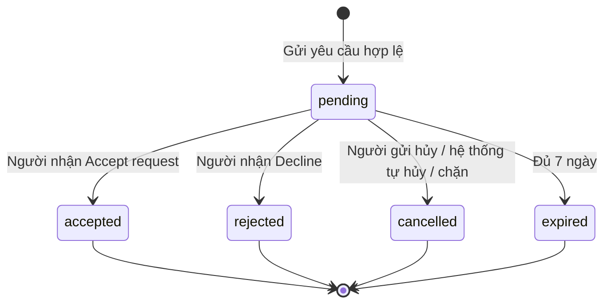

# Messages — Luồng sử dụng và quy tắc hoạt động

Cập nhật: **05/11/2026**, đối chiếu với code hiện tại.

Tài liệu dành cho mọi thành viên trong nhóm: đọc để hiểu tính năng, trao đổi nghiệp vụ hoặc kiểm thử trên giao diện. Nội dung giải thích bằng tiếng Việt; tên tab, nút và trạng thái giữ tiếng Anh như trên ứng dụng.

## 1. Hiểu nhanh trong một phút

Messages cho phép hai người trao đổi riêng về một project. Khi chưa có quyền trò chuyện, một bên gửi **yêu cầu kèm lời mở đầu**; bên còn lại cần chấp nhận trước khi hai người có thể nhắn qua lại.

Các nguyên tắc chính:

- **Cả leader và thành viên đều có thể chủ động liên hệ.** Project được chọn phải do một trong hai người làm leader.
- **Mỗi cặp người dùng chỉ có một phòng trò chuyện**, dù trao đổi nhiều project hoặc đổi chiều người gửi.
- **Mỗi cặp chỉ có một yêu cầu đang chờ.** Trong lúc chờ, không thể gửi thêm tin chat hoặc tạo thêm yêu cầu cho cặp đó.
- **Chấp nhận chat chỉ cấp quyền trò chuyện.** Không tự tạo/duyệt đơn apply, không chấp nhận lời mời tham gia và không thêm người vào team.
- Khi đã có quyền chat, hai bên dùng phòng hiện có. Project hoặc đơn apply kết thúc không tự đóng phòng đó.

Ví dụ: An gửi yêu cầu cho Bình về Project A. Bình chấp nhận, hai người có một phòng chung. Sau đó họ muốn trao đổi Project B thì vẫn dùng phòng này và có thể chia sẻ thêm thẻ Project B.

## 2. Messages gồm những khu vực nào?

| Khu vực trên UI | Dùng để làm gì? |
| --- | --- |
| **Conversations** | Xem các phòng đã được cấp quyền chat, tìm người và gửi/đọc tin. |
| **Requests → Received** | Xem yêu cầu người khác gửi đến mình. |
| **Requests → Sent** | Xem yêu cầu mình đã gửi đi. |
| **Pending requests** | Bộ lọc mặc định, chỉ hiện yêu cầu còn đang chờ. |
| **All activity** | Xem cả yêu cầu đang chờ và lịch sử Accepted, Declined, Cancelled, Expired. |
| **Blocked contacts** | Danh sách những người chính mình đã chặn, kèm thao tác Unblock. |

Hai loại số đếm được tách riêng:

- **Unread messages**: số tin chat chưa đọc trong các phòng đã có quyền trò chuyện.
- **Pending requests**, có nhãn `req` ở menu: số yêu cầu hợp lệ đang chờ **mình phản hồi**. Không tính yêu cầu mình gửi hoặc yêu cầu đã kết thúc.

Lời mở đầu của một yêu cầu Pending chưa được tính là tin chat chưa đọc. Sau khi chấp nhận, lời mở đầu mới được đưa vào lịch sử phòng.

## 3. Sơ đồ tổng quan

Trong toàn bộ luồng, nếu có chặn hoặc tài khoản không còn đủ điều kiện sử dụng, hệ thống có thể từ chối thao tác liên hệ. Sơ đồ không có nghĩa phòng đã tồn tại sẽ bỏ qua các kiểm tra này.

## 4. Bắt đầu liên hệ từ đâu?

| Điểm bắt đầu | Thao tác và ngữ cảnh |
| --- | --- |
| **Member profile** | Chọn **Request a conversation** trong thẻ thông tin thành viên. Nếu đã có phòng, nút đổi thành **Open conversation**. |
| **Project detail** | Chọn **Message leader**. Đã có phòng thì mở phòng; chưa có thì mở biểu mẫu yêu cầu với project liên quan. |
| **Project applications** của leader | Với đơn Pending, chọn **Discuss application** tại ứng viên cần trao đổi. Project và vị trí được điền theo đơn. |
| **Candidate detail** | Chọn **Discuss project** khi ngữ cảnh project/vị trí cho phép. |
| **Messages → Conversations** | Gõ ít nhất hai ký tự vào **Search people to chat…**, rồi chọn người trong kết quả. Có phòng thì mở phòng; chưa có thì mở biểu mẫu yêu cầu. |

Việc tìm thấy một tài khoản không đồng nghĩa có thể nhắn ngay. Hai người vẫn cần ngữ cảnh project hợp lệ và sự đồng ý trò chuyện.

### Chọn Project và Position / topic

Biểu mẫu đã tách thành hai ô để tránh danh sách lặp tên project theo từng vị trí:

1. **Project**: mỗi project chỉ xuất hiện một lần, lấy từ các project còn tuyển mà một trong hai người làm leader.
2. **Position / topic**: chỉ hiện các vị trí hoặc chủ đề phù hợp thuộc project đang chọn.
3. Khi đổi Project, lựa chọn Position / topic cũ được xóa. Cần chọn lại trước khi gửi; nội dung đang soạn vẫn giữ.

Nếu mở từ một project hoặc đơn apply cụ thể, hệ thống ưu tiên điền ngữ cảnh tương ứng khi ngữ cảnh đó còn hợp lệ. Người gửi cần kiểm tra lại trước khi gửi.

| Tình huống | Ngữ cảnh của yêu cầu |
| --- | --- |
| Leader liên hệ ứng viên có đơn Pending ở vị trí đã chọn | Tự gắn đúng đơn apply; UI thể hiện mục đích trao đổi về đơn ứng tuyển. |
| Leader liên hệ người chưa có đơn Pending ở vị trí đã chọn | Mời trao đổi về cơ hội tham gia project; leader phải chọn một vị trí đang tuyển. |
| Thành viên liên hệ leader, chọn vị trí có đơn Pending của mình | Tự gắn đúng đơn apply của thành viên tại vị trí đó. |
| Thành viên liên hệ leader, chọn vị trí khác còn tuyển | Hỏi về project/vị trí đó, không tự tạo đơn apply. |
| Thành viên chọn **General project inquiry** | Hỏi chung về project; không gắn vị trí hoặc đơn apply, kể cả thành viên đang có đơn ở một vị trí khác. |

Nếu không có ngữ cảnh hợp lệ, biểu mẫu thông báo không có project đang mở để liên hệ và không cho gửi.

## 5. Luồng chính: gửi yêu cầu → chấp nhận → trò chuyện

Gọi **A** là người gửi và **B** là người nhận. A có thể là leader hoặc thành viên.

| Bước | Ai thực hiện? | Thao tác | Kết quả |
| ---: | --- | --- | --- |
| 1 | A | Mở biểu mẫu từ một điểm bắt đầu ở mục 4. | Thấy tên người nhận, Project, Position / topic và Opening message. |
| 2 | A | Kiểm tra project/vị trí, nhập **Opening message**. | Lời mở đầu bắt buộc, không chỉ gồm khoảng trắng, tối đa 500 ký tự. |
| 3 | A | Bấm **Send request**. | Nếu hợp lệ, tạo một yêu cầu **Pending**, chuyển A đến **Requests → Sent**. |
| 4 | B | Mở **Messages → Requests → Received**. | Thấy tên A, project/vị trí, mục đích, lời mở đầu và hạn phản hồi. |
| 5 | B | Bấm **Accept request**. | Hệ thống kiểm tra lại hiệu lực yêu cầu, cấp quyền chat rồi mở phòng cho B. |
| 6 | A | Mở **Conversations**, hoặc **Sent → All activity → Open conversation**. | Mở cùng phòng với B; không phải một phòng khác theo chiều gửi. |
| 7 | A và B | Nhập tin vào **Write a message…**, bấm Send hoặc Enter. | Tin được lưu và đồng bộ cho hai bên. |

Sau bước 5, lời mở đầu xuất hiện **đúng một lần** trong phòng, kèm thẻ project và vị trí nếu có. Việc chấp nhận không tiêu thêm lượt gửi yêu cầu.

### Nếu đã có yêu cầu Pending thì sao?

- Không tạo thêm yêu cầu, dù đổi project hoặc đổi chiều người gửi.
- Hệ thống đưa người dùng về danh sách yêu cầu theo chiều phù hợp; yêu cầu cũ giữ nguyên nội dung.
- Nếu A đã gửi cho B rồi B cũng muốn liên hệ A, B cần **Accept request** của A. Việc B thử gửi lại không tự được xem là chấp nhận.

## 6. Từ chối, hủy và hết hạn

| UI hiển thị | Trạng thái lưu | Ý nghĩa |
| --- | --- | --- |
| **Pending** | `pending` | Chưa có phản hồi, chưa được nhắn qua lại. Người gửi có **Cancel request**; người nhận có **Accept request**, **Decline**, **Block**. |
| **Accepted** | `accepted` | Đã cấp quyền chat. Có thể chọn **Open conversation**. |
| **Declined** | `rejected` | Người nhận từ chối. Không cấp quyền chat từ yêu cầu này. |
| **Cancelled** | `cancelled` | Người gửi hủy, hoặc hệ thống hủy do chặn/ngữ cảnh kết thúc. |
| **Expired** | `expired` | Đã đủ 7 × 24 giờ từ lúc tạo mà chưa được chấp nhận. |

Trạng thái cuối không quay lại Pending. Muốn liên hệ lại phải **tạo yêu cầu mới**; lịch sử cũ vẫn giữ ở All activity.

Sau Decline, Cancelled hoặc Expired, cả hai phía đều có thể chủ động gửi yêu cầu mới ngay nếu còn ngữ cảnh hợp lệ, không bị chặn và còn hạn mức. Không có thời gian chờ riêng chỉ vì bị Decline.

### Khi nào hệ thống tự hủy Pending?

| Sự kiện | Yêu cầu bị ảnh hưởng |
| --- | --- |
| Project đóng tuyển, hết hạn tuyển, hoàn thành hoặc bị lưu trữ/xóa | Các yêu cầu Pending gắn với project đó. |
| Vị trí ngừng tuyển hoặc đủ chỗ | Các yêu cầu Pending gắn với vị trí đó. |
| Đơn apply được Accepted, Rejected hoặc Withdrawn | Các yêu cầu Pending gắn với đúng đơn đó. |
| Một bên chặn bên còn lại | Yêu cầu Pending giữa hai người. |

**Phân biệt phạm vi:** đóng một vị trí không hủy yêu cầu General project inquiry nếu project vẫn còn tuyển. Kết thúc một đơn apply không hủy yêu cầu không gắn với đơn đó. Hệ thống không tự chuyển yêu cầu cũ sang một vị trí khác.

Những thay đổi project/apply trên không thu hồi quyền chat đã được chấp nhận hợp lệ trước đó. Nếu ngữ cảnh đã kết thúc trước khi người nhận chấp nhận, hệ thống không cấp quyền chat từ yêu cầu đã mất hiệu lực. Mở tuyển lại cũng không tự khôi phục yêu cầu cũ.

## 7. Giới hạn để tránh spam

| Quy tắc | Giá trị |
| --- | --- |
| Yêu cầu mới trong 60 phút gần nhất | Tối đa **5** yêu cầu cho mỗi tài khoản. |
| Yêu cầu mới trong 24 giờ gần nhất | Tối đa **20** yêu cầu cho mỗi tài khoản. |
| Phạm vi tính | Cộng chung mọi người nhận và mọi project của người gửi. |
| Thời hạn Pending | **7 ngày** từ lúc tạo; xem yêu cầu không gia hạn thời gian. |
| Lời mở đầu | Bắt buộc, tối đa **500 ký tự**, không sửa sau khi đã gửi. |

Đây là cửa sổ thời gian trượt, không phải đếm lại từ đầu vào mỗi giờ hoặc lúc 0 giờ. Ví dụ, một lượt tạo lúc 09:20 rời cửa sổ 60 phút lúc 10:20; hệ thống vẫn phải kiểm tra cả giới hạn 24 giờ.

- Chỉ yêu cầu **mới tạo thành công** mới tính lượt. Tạo lỗi, gặp Pending hiện có hoặc mở phòng đã có quyền không tiêu lượt mới.
- Decline, Cancelled và Expired **không hoàn lượt đã dùng**. Gửi lại thành công là một lượt mới.
- Gặp giới hạn thì UI hiển thị thời điểm có thể thử lại; nội dung đang soạn không bị xóa do lỗi gửi.
- Retry cùng lần gửi và cùng nội dung dùng lại mã yêu cầu để tránh tạo trùng hoặc tính hai lượt. Thay đổi nội dung là một lần gửi khác.
- Nhắn trong phòng đã có quyền và chia sẻ thẻ project không thuộc hạn mức 5/20 dành cho yêu cầu mới.

## 8. Khi đã có phòng trò chuyện

Với dữ liệu chuyển đổi từ phiên bản cũ, migration giữ quyền chat cho phòng đã có lịch sử tin nhắn. Phòng cũ còn rỗng vẫn cần qua yêu cầu trước; việc chỉ có một mã phòng không đủ để được gửi tin.

### Gửi và nhận tin

- Tin nhắn văn bản tối đa **4.000 ký tự**; không gửi được nội dung trống hoặc chỉ có khoảng trắng.
- Hai bên nhận cập nhật tin mới và số chưa đọc dù đang mở một phòng khác, miễn phiên ứng dụng còn kết nối.
- Trong phòng đang mở, tin mới được thêm vào đúng lịch sử. Khi chuyển nhanh giữa các phòng, kết quả tải của phòng cũ không được ghi đè phòng mới.
- Nếu chưa xác nhận được gửi thành công, UI báo lỗi và giữ nội dung để thử lại. Cùng lần gửi được nhận diện để tránh lưu hai bản tin do retry hoặc sự kiện đến cùng lúc với phản hồi gửi.

### Đọc tin và lịch sử

- Mỗi lần tải lấy tối đa **50 tin**. Dùng **Load older messages** để đọc lịch sử cũ hơn.
- Khi mở phòng có tin chưa đọc, ứng dụng tải thêm lịch sử nếu cần để tìm tin chưa đọc đầu tiên.
- **New messages** là một vạch ở tin chưa đọc đầu tiên; **Jump to first unread** cuộn đến vị trí đó.
- UI tự cập nhật mốc đã đọc đến tin cuối xuất hiện trong vùng xem khi tab đang hiển thị và cửa sổ có focus. Các tin trước mốc này được tính đã đọc; đây không phải xác nhận người dùng đã đọc hiểu từng tin.
- Chỉ bấm Jump không đánh dấu toàn bộ phòng đã đọc. Cơ chế cập nhật dựa trên vùng tin đang hiển thị.
- Ngày được nhóm theo **Today**, **Yesterday** hoặc ngày thực tế, theo giờ địa phương của người xem.

### Trao đổi thêm project khác

1. Mở project muốn chia sẻ, chọn **Share project** khi đã có phòng với leader; hoặc dùng điểm chia sẻ ngữ cảnh đang có trên UI.
2. Chọn Project và Position / topic còn hợp lệ, nhập nội dung rồi bấm **Share project** trong biểu mẫu.
3. Thẻ project và nội dung xuất hiện trong **phòng hiện có**.

Chia sẻ project vẫn cần qua kiểm tra ngữ cảnh và quyền liên hệ. Không tạo phòng mới, không tạo yêu cầu chờ và không thay đổi đơn apply hoặc membership.

## 9. Chặn và bỏ chặn

Có thể **Block** từ yêu cầu đã nhận đang Pending hoặc từ header của phòng chat. Có thể **Unblock** tại phòng hoặc **Requests → Blocked contacts** đối với lượt chặn do chính mình tạo.

| Tình huống | Kết quả |
| --- | --- |
| A chặn B khi đang Pending | Yêu cầu bị Cancelled. Không được gửi yêu cầu hoặc tin chat mới theo cả hai chiều. |
| A chặn B khi đã có phòng | Giữ lịch sử và quyền chat đã cấp, nhưng tạm ngăn gửi tin theo cả hai chiều. |
| A bỏ chặn B, không còn lượt chặn nào, trước đó đã có quyền chat | Hai bên tiếp tục dùng phòng cũ, không cần yêu cầu mới. |
| A bỏ chặn B, trước đó chưa có quyền chat | Yêu cầu đã hủy không phục hồi. Cần tạo yêu cầu mới nếu đủ điều kiện. |
| A và B cùng chặn nhau, chỉ A bỏ chặn | Vẫn ngăn liên hệ vì lượt chặn của B còn hiệu lực. |

Mỗi người chỉ gỡ được lượt chặn của chính mình. Thông báo không thể liên hệ không phải cách xác định ai đã chặn ai; giao diện không công bố danh sách chặn của đối phương.

## 10. Mất mạng, kết nối lại và thông báo

Trong header của phòng, **Connected**, **Connecting…**, **Reconnecting…** hoặc **Offline — retrying…** là trạng thái kết nối chat của ứng dụng đang dùng. **Connected không có nghĩa người còn lại đang online.**

Luồng đồng bộ hiện tại:

1. Khi có kết nối realtime, hệ thống nhận thay đổi tin nhắn, yêu cầu và mốc đã đọc qua SignalR.
2. Khi chưa có kết nối realtime, gửi tin có thể dùng REST nếu API vẫn truy cập được. Điều này không có nghĩa gửi được khi máy mất mạng hoàn toàn.
3. Sau kết nối lại hoặc khi quay lại tab, ứng dụng tải lại dữ liệu; khi tab hiển thị còn có lượt đồng bộ định kỳ khoảng 15 giây để bù sự kiện bị lỡ.
4. Backend kiểm tra hiệu lực yêu cầu tại thời điểm đọc/thao tác, đồng thời có tác vụ nền xử lý vòng đời khoảng 5 giây. Không thể chấp nhận yêu cầu hết hạn chỉ vì UI chưa cập nhật.

Dữ liệu API quyết định trạng thái cuối; cập nhật realtime có thể đến chậm khi mạng gián đoạn. Nếu danh sách yêu cầu chưa cập nhật, dùng **Refresh requests** hoặc mở lại trang để đối chiếu.

Phạm vi hiện tại là cập nhật trong Messages. Yêu cầu chat chưa tạo email, push bên ngoài hoặc thông báo riêng trong hệ thống chuông Notifications. UI cũng chưa có trạng thái online thực của đối phương, tick xác nhận đã đọc từng tin, hoặc luồng đính kèm file riêng trong chat.

## 11. Bài kiểm thử nhanh cho cả nhóm

Chuẩn bị hai tài khoản A/B active, đã hoàn tất onboarding, đăng nhập bằng hai browser profile riêng. A làm leader một project đang tuyển và có vị trí còn mở. B có thể là thành viên quan tâm project đó. Frontend/backend cần chạy bản tương thích và database đã có migration tương ứng với tính năng.

| # | Thử nghiệm | Kết quả cần thấy |
| ---: | --- | --- |
| 1 | A vào hồ sơ B, gửi yêu cầu với lời mở đầu dễ nhận diện. | A thấy ở Sent, B thấy ở Received; chưa thể nhắn qua lại. |
| 2 | Trong lúc Pending, thử liên hệ lại hoặc để B thử gửi ngược. | Vẫn chỉ một yêu cầu Pending; không tự chấp nhận. |
| 3 | B chọn Accept request. | Có một phòng chung, lời mở đầu và thẻ project xuất hiện một lần; team/apply không đổi. |
| 4 | A gửi tin trong lúc B đang mở một phòng khác. | B nhận cập nhật inbox và số chưa đọc. |
| 5 | B mở phòng, cuộn xem tin rồi chuyển focus sang ứng dụng khác. | Mốc đọc cập nhật theo vùng xem khi có focus; không tự đọc mọi tin chỉ vì phòng đang mở. |
| 6 | A chia sẻ project khác còn hợp lệ giữa hai người. | Thẻ mới vào cùng phòng, không tạo phòng hoặc yêu cầu mới. |
| 7 | A Block B, thử gửi từ hai phía, rồi A Unblock. | Khi chặn không gửi được; bỏ hết chặn thì phòng đã có quyền tiếp tục hoạt động. |
| 8 | Với cặp chưa có quyền chat, người nhận Decline, người gửi gửi lại. | Có yêu cầu mới nếu còn điều kiện/hạn mức; yêu cầu Declined vẫn ở All activity. |
| 9 | Với yêu cầu Pending, đóng vị trí hoặc kết thúc đơn apply được gắn. | Đúng yêu cầu bị Cancelled, có lý do; phòng đã chấp nhận trước đó vẫn dùng được. |
| 10 | Đổi Project trong biểu mẫu. | Danh sách Position / topic đổi theo, lựa chọn vị trí cũ bị xóa, lời mở đầu đang nhập giữ nguyên. |
| 11 | Ngắt/kết nối lại mạng rồi quay lại tab Messages. | Trạng thái kết nối đổi và dữ liệu được tải bù; tin đã lưu không bị nhân đôi. |

Các tình huống cần chờ 7 ngày, chạm quota hoặc kiểm tra tranh chấp đồng thời nên dùng dữ liệu/môi trường kiểm thử phù hợp. Danh sách trên là bài thử nhanh; ma trận nghiệp vụ đầy đủ nằm trong đặc tả bên dưới.

## 12. Tài liệu liên quan và vị trí code

| Cần tìm hiểu | Nơi đọc |
| --- | --- |
| Quy tắc sản phẩm và ma trận nghiệm thu đầy đủ | [MESSAGE_REQUESTS_SPEC.md](MESSAGE_REQUESTS_SPEC.md) |
| API gửi yêu cầu, phản hồi, ngữ cảnh và block | [CHAT_REQUESTS_API.md](../api/CHAT_REQUESTS_API.md) |
| API phòng, tin nhắn, phân trang và mốc đọc | [CHAT_API.md](../api/CHAT_API.md) |
| Triển khai, migration và các đợt kiểm thử đã ghi nhận | [CHAT_REQUESTS_IMPLEMENTATION.md](CHAT_REQUESTS_IMPLEMENTATION.md) |
| Phân biệt chat với lời mời tham gia team | [TEAMMATE_FLOW.md](TEAMMATE_FLOW.md) |
| Luồng chuông Notifications riêng | [NOTIFICATION_FLOW.md](NOTIFICATION_FLOW.md) |

Điểm vào code dành cho developer:

- Frontend, repo `tindy-platform-frontend`: `src/pages/messages/MessagesScreen.tsx`, `src/components/messages/ChatRequestButton.tsx`, `src/components/messages/ChatRequestsPanel.tsx`, `src/services/ChatContext.tsx`.
- Backend: [ChatRequests.cs](../../src/Tindy.Infrastructure/Repositories/ChatRequests.cs), [ChatService.cs](../../src/Tindy.Application/Services/ChatService.cs), [ChatHub.cs](../../src/Tindy.Api/Hubs/ChatHub.cs), [ChatRequestWorker.cs](../../src/Tindy.Api/Hubs/ChatRequestWorker.cs).

Tài liệu này mô tả hành vi trong code tại ngày cập nhật, không xác nhận trạng thái triển khai hoặc migration của từng môi trường.
