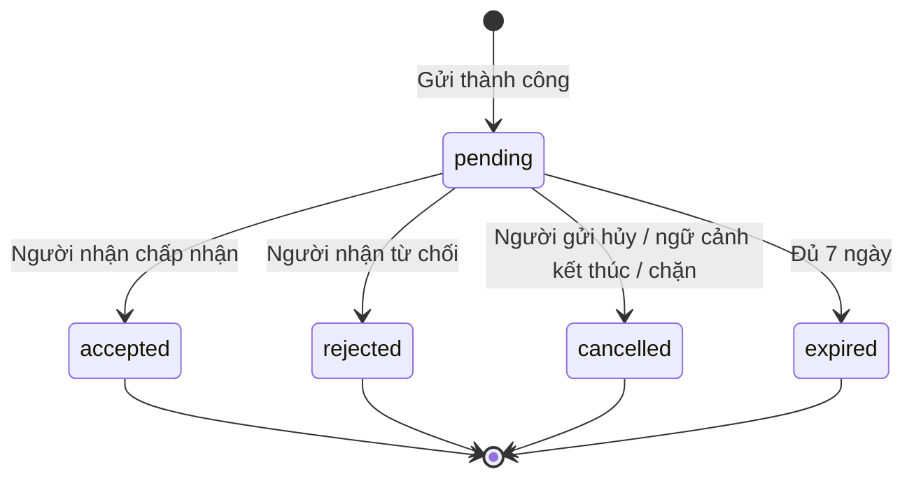

# Đặc tả yêu cầu trò chuyện — V1

Ngày: 05/11/2026. Trạng thái: đã chốt quy tắc sản phẩm, sẵn sàng thiết kế kỹ thuật và triển khai; chưa phải chức năng đã có trong mã.

Tài liệu này ghi lại các quyết định đã thống nhất, luồng sử dụng và tiêu chí nghiệm thu. Hợp đồng chat hiện có nằm ở [CHAT_API.md](../api/CHAT_API.md). Chưa thay đổi API, database hoặc giao diện trong bước đặc tả này.

## 1. Các quyết định đã chốt

| Chủ đề | Quy tắc |
|---|---|
| Ai được gửi | Cả leader và thành viên, với tài khoản active và đã hoàn thành onboarding. Không tự gửi cho mình. |
| Ngữ cảnh | Yêu cầu đầu tiên bắt buộc gắn với project. Người ở phía leader phải là leader của project đó. |
| Leader → người đã apply | “Trao đổi về đơn ứng tuyển”, gắn với đơn apply đang pending và vị trí của đơn. |
| Leader → người chưa apply | “Mời trao đổi về cơ hội tham gia project”, gắn với project và vị trí đang tuyển. |
| Thành viên → leader | Hỏi hoặc trao đổi về project; có thể chọn vị trí quan tâm. |
| Đồng ý | Người nhận phải chấp nhận trước khi hai bên được nhắn qua lại. Đồng ý chat không thay đổi đơn apply, lời mời tham gia hoặc tư cách thành viên project. |
| Số phòng | Một phòng cho mỗi cặp người dùng, không phân biệt chiều gửi hoặc project. |
| Đã có quyền chat | Mở phòng hiện có, không yêu cầu lại khi trao đổi project khác; bổ sung thẻ ngữ cảnh project. |
| Đang chờ | Mỗi cặp chỉ có một yêu cầu pending, kể cả khi đổi chiều gửi hoặc chọn project khác. Chưa được gửi thêm tin. |
| Từ chối | Được gửi yêu cầu mới ngay; mỗi lần tạo thành công tính thêm một lượt. |
| Hủy | Người gửi được hủy yêu cầu đang chờ. Giữ lịch sử và lý do, không xóa bản ghi ở phía người nhận. |
| Chặn | Khi một trong hai người chặn người còn lại, ngăn yêu cầu và tin nhắn mới theo cả hai chiều. |
| Hạn mức | Mỗi tài khoản tối đa 5 yêu cầu trong 60 phút và 20 yêu cầu trong 24 giờ gần nhất, tính chung mọi người nhận/project. |
| Hoàn hạn mức | Không hoàn lượt khi yêu cầu bị từ chối, hủy, tự hủy hoặc hết hạn. |
| Hết hạn | Sau đúng 7 × 24 giờ kể từ lúc tạo. Có thể tạo mới nếu ngữ cảnh còn hợp lệ và còn hạn mức. |
| Tự hủy | Khi project đóng tuyển, hết hạn tuyển, hoàn thành, bị lưu trữ/xóa; hoặc đơn apply liên quan được accepted/rejected/withdrawn. |
| Phòng đã chấp nhận | Tiếp tục hoạt động khi project/đơn apply kết thúc, trừ khi có chặn hoặc tài khoản không còn được phép sử dụng. |
| Bố cục Messages | Hai tab “Trò chuyện” và “Yêu cầu”; Yêu cầu chia “Đã nhận” / “Đã gửi”. |
| Lời mở đầu | Bắt buộc, trim trước khi kiểm tra, tối đa 500 ký tự; không sửa sau khi gửi. Có thể hủy rồi tạo mới và chịu quota. |
| Phòng chat cũ | Giữ quyền chat cho phòng đã có tin nhắn trước ngày chuyển đổi; phòng rỗng phải qua yêu cầu trước. Thống kê trước migration và ghi nguồn quyền legacy. |
| Vị trí ngừng tuyển | Vị trí filled/closed làm tự hủy yêu cầu pending gắn với vị trí đó, kể cả project vẫn tuyển vị trí khác. Yêu cầu hỏi chung về project giữ nguyên nếu project còn tuyển; phòng đã chấp nhận tiếp tục hoạt động. Không tự đổi ngữ cảnh yêu cầu cũ sang vị trí khác. |
| Thành viên chọn ngữ cảnh | Chọn vị trí có đơn apply pending thì tự gắn đúng đơn và hiển thị “Trao đổi về đơn ứng tuyển”. Có nhiều đơn/vị trí thì người gửi chọn rõ vị trí. Chọn “Hỏi về project” thì không gắn đơn hoặc vị trí, chỉ phụ thuộc trạng thái tuyển của project. |
| Chặn và bỏ chặn | Chặn hủy pending và ngăn yêu cầu/tin nhắn mới theo cả hai chiều, giữ lịch sử và quyền chat đã được chấp nhận. Chỉ người tạo lượt chặn được gỡ lượt chặn đó. Bỏ chặn không khôi phục yêu cầu đã hủy; nếu còn lượt chặn phía kia thì vẫn không được liên hệ. Khi không còn block, cặp đã được cấp quyền chat được tiếp tục chat, cặp chưa được cấp quyền phải gửi yêu cầu mới. |

## 2. Luồng người dùng

### Leader liên hệ người đã apply

1. Leader mở đơn apply pending của project mình quản lý.
2. Chọn “Trao đổi về đơn ứng tuyển”. Nếu đã có quyền chat thì mở phòng cũ; nếu có pending giữa hai người thì mở yêu cầu đó.
3. Nhập lời mở đầu; màn hình xác nhận hiển thị người nhận, project và vị trí lấy từ đơn apply.
4. Sau khi gửi, yêu cầu xuất hiện ở Đã gửi của leader và Đã nhận của ứng viên. Không được nhắn bổ sung khi đang chờ.
5. Ứng viên có thể Chấp nhận, Từ chối hoặc Chặn. Chấp nhận mở phòng dùng chung và giữ lời mở đầu cùng ngữ cảnh.
6. Nếu đơn kết thúc trước khi yêu cầu được chấp nhận, tự hủy yêu cầu và hiện lý do tương ứng.

### Leader liên hệ người chưa apply

1. Từ hồ sơ/kết quả tìm đồng đội, leader chọn “Mời trao đổi về cơ hội tham gia project”.
2. Chọn project mình quản lý và vị trí đang tuyển, rồi nhập lời mở đầu.
3. Gửi yêu cầu và chờ người nhận quyết định như luồng trên.
4. Chấp nhận chat không tự tạo đơn apply hay lời mời tham gia project. Hai nghiệp vụ đó vẫn được thực hiện riêng.

### Thành viên liên hệ leader

1. Từ project đang tuyển, thành viên chọn “Yêu cầu trò chuyện với leader”.
2. Người nhận được xác định từ leader của project; không được thay recipient bằng tài khoản khác.
3. Có thể chọn vị trí quan tâm rồi nhập lời mở đầu.
4. Nếu người gửi chọn vị trí có đơn apply pending của mình tại project này, tự gắn đúng đơn và hiển thị rõ “Trao đổi về đơn ứng tuyển” trước khi gửi. Có nhiều đơn/vị trí thì người gửi chọn vị trí, không tự chọn tùy tiện. Khi đơn kết thúc thì yêu cầu gắn với đơn đó tự hủy.
5. Nếu chọn “Hỏi về project”, không gắn application hoặc position dù người gửi đang có đơn apply. Yêu cầu này chỉ phụ thuộc vòng đời tuyển của project, không tự hủy khi một đơn hay vị trí riêng lẻ kết thúc.

### Hai người đã có phòng được chấp nhận

- Mở phòng hiện có, không tạo yêu cầu hay trừ hạn mức.
- Có thể bổ sung thẻ project mới để phân biệt nội dung trao đổi. Thẻ là ngữ cảnh, không tạo phòng hoặc cấp quyền quản lý project.
- Giữ lịch sử dù project cũ không còn tuyển. Thẻ chỉ hiển thị thông tin người xem được phép truy cập.

## 3. Trạng thái và thao tác

Các trạng thái cuối không quay về pending. Gửi lại tạo bản ghi mới; yêu cầu cũ giữ nguyên để truy vết. Chặn là quan hệ riêng giữa hai người, không phải trạng thái của phòng hoặc một yêu cầu duy nhất.

| Trạng thái hiệu lực | Người gửi | Người nhận |
|---|---|---|
| pending, còn hợp lệ | Xem, Hủy | Xem, Chấp nhận, Từ chối, Chặn |
| accepted | Mở phòng chat | Mở phòng chat |
| rejected/cancelled/expired | Xem lịch sử; tạo mới nếu đủ điều kiện | Xem lịch sử |

Mỗi bản ghi lưu lý do kết thúc riêng với trạng thái: sender_cancelled, project_closed, application_accepted, application_rejected, application_withdrawn, position_closed, blocked. Người gửi không được xem danh tính người chặn hoặc thông tin riêng tư qua thông báo lỗi; có thể hiển thị “Không thể tiếp tục liên hệ”.

## 4. Thời gian, hạn mức và dữ liệu

- Backend quyết định mọi mốc thời gian bằng UTC; frontend chuyển sang giờ địa phương. Không tin đồng hồ client.
- Project còn tuyển phải thỏa `RecruitmentDeadline.IsOpen(project, now)` của hệ thống, không chỉ kiểm tra chuỗi trạng thái `recruiting`. Project hiện có `LeaderId`, `RecruitmentClosesAt`, `ArchivedAt`.
- Nếu yêu cầu gắn với một vị trí, vị trí đó phải còn mở khi tạo và chấp nhận. Khi chuyển filled/closed, tự hủy pending liên quan với lý do position_closed, hiển thị “Vị trí đã ngừng tuyển”. Muốn trao đổi vị trí khác phải tạo yêu cầu mới nếu chưa có quyền chat, chịu quota như bình thường.
- Đơn apply liên quan phải pending. Trạng thái kết thúc hiện có là accepted, rejected, withdrawn.
- Với thời điểm T, đếm yêu cầu tạo thành công trong `(T − 60 phút, T]` và `(T − 24 giờ, T]`. Đạt một trong hai ngưỡng thì từ chối tạo mới và trả thời điểm thử lại sớm nhất khi cả hai hạn mức cho phép.
- Request không hợp lệ, bị chặn, trùng pending hoặc lỗi lưu không tiêu lượt. Retry cùng khóa idempotency và cùng nội dung trả cùng kết quả, không tạo bản ghi mới hoặc trừ hai lần. Tái sử dụng khóa cho nội dung khác phải bị từ chối.
- `ExpiresAt = CreatedAt + 7 ngày`; tại `now >= ExpiresAt` không được chấp nhận. Không gia hạn bởi hành động xem yêu cầu.
- Gửi lại ngay sau từ chối/hủy/hết hạn vẫn cần qua kiểm tra project, apply, block và hạn mức hiện tại. Project mở tuyển lại không tự phục hồi yêu cầu cũ.
- Các thông tin tối thiểu của yêu cầu: ID, người gửi/nhận, cặp người dùng chuẩn hóa, project, vị trí tùy luồng, đơn apply tùy chọn, loại ngữ cảnh, lời mở đầu, trạng thái, lý do kết thúc, CreatedAt/ExpiresAt/RespondedAt, khóa idempotency và conversation liên quan nếu đã được chấp nhận.
- Lời mở đầu lưu tại yêu cầu. Sau chấp nhận xuất hiện đúng một lần trong lịch sử phòng; chưa chấp nhận thì không được tính là tin chat chưa đọc thông thường.

## 5. Quyền truy cập và tính đồng thời

- Chỉ hai bên được đọc yêu cầu. Chỉ recipient được chấp nhận/từ chối; chỉ sender được hủy. Kiểm tra lại phía server, không dựa vào nút ẩn trên UI.
- Mọi đường gửi tin phải kiểm tra quyền chat đã được chấp nhận và không có block: HTTP, SignalR và bất kỳ lối gọi cũ nào. Tạo được conversation hoặc biết conversation ID không đồng nghĩa với có quyền gửi.
- Endpoint tạo direct conversation hiện có không được tiếp tục là đường bỏ qua sự đồng ý. Khi triển khai phải chuyển thành lấy/mở phòng có quyền hoặc trả yêu cầu đang chờ, với hợp đồng API được cập nhật đồng bộ.
- Ràng buộc database bảo đảm tối đa một pending cho cặp chuẩn hóa và một phòng cho cặp. Việc cấp quyền chat, chuyển trạng thái yêu cầu và ghi lời mở đầu phải trong cùng transaction.
- Hai yêu cầu ngược chiều cùng lúc: chỉ một pending tồn tại; phía còn lại nhận thông tin pending hiện có và có thể chấp nhận. Không tự xem hành động gửi là chấp nhận.
- Quota phải được kiểm tra và ghi nhận nguyên tử theo tài khoản, hoạt động đúng qua nhiều tab/instance. Tránh kiểm tra count rồi insert độc lập.
- Accept/reject/cancel đồng thời: chỉ một chuyển trạng thái pending thành công; thao tác còn lại nhận trạng thái hiện tại, không ghi đè kết quả.
- Chấp nhận và project/apply kết thúc: kiểm tra ngữ cảnh trong transaction với cơ chế đồng bộ cùng các luồng đóng project/kết thúc apply. Nếu ngữ cảnh kết thúc đã commit trước, không được mở chat. Nếu accept hoàn tất hợp lệ trước, giữ phòng đã được chấp nhận.
- Block và gửi/accept đồng thời: kiểm tra và tuần tự hóa trên cặp người dùng. Sau khi block commit không được lưu thêm tin hay cấp quyền chat mới; không thu hồi tin đã commit trước đó.
- Tác vụ nền cập nhật cancelled/expired để dọn trạng thái. Mọi API đọc và thao tác vẫn phải xét trạng thái hiệu lực, deadline và block ngay tại thời điểm gọi; không được chấp nhận yêu cầu hết hạn vì job chưa chạy.
- Mọi luồng đóng tuyển, đổi hạn tuyển, archive/delete project, accept/reject/withdraw apply và chuyển vị trí sang filled/closed phải được rà soát; không chỉ xử lý một controller. Khi đánh giá hiệu lực trùng nhiều lý do, dùng thứ tự xác định: block → project không còn tuyển → apply kết thúc → vị trí ngừng tuyển → hết hạn.

## 6. Giao diện và đồng bộ

- “Trò chuyện” chỉ liệt kê các cặp đã được cấp quyền chat; pending không xuất hiện như phòng đã mở.
- Mỗi thẻ yêu cầu hiển thị tên/avatar, chiều gửi, project, vị trí nếu có, mục đích, lời mở đầu, thời điểm gửi, hạn và trạng thái/lý do kết thúc phù hợp quyền xem.
- Đã nhận ưu tiên pending, có bộ lọc xem lịch sử. Đã gửi phân biệt pending và các kết quả cuối.
- Badge yêu cầu đếm pending hợp lệ đã nhận; không cộng các yêu cầu đã gửi hoặc đã kết thúc. Badge tin nhắn đếm tin chưa đọc trong phòng đã chấp nhận; hai số có nhãn riêng, không nhập nhằng.
- Chạm giới hạn: giữ nội dung đang soạn và cho biết thời điểm gửi lại. Không mất bản nháp khi request thất bại hoặc đổi project.
- Phát thay đổi tới mọi kết nối của hai bên khi tạo/chấp nhận/từ chối/hủy/hết hạn. Mất sự kiện thì tải lại danh sách và badge sau reconnect/foreground; kết quả server là nguồn xác thực cuối.
- Thông báo trong Messages thuộc phạm vi V1. Việc bổ sung yêu cầu chat vào hệ thống Notifications chung chưa được chốt; không tự gửi email hoặc push bên ngoài.

## 7. Tiêu chí kiểm thử nghiệm thu

| ID | Tình huống | Kết quả bắt buộc |
|---|---|---|
| MR01 | Leader gửi từ đơn pending thuộc project mình | Đúng recipient, project, position và application; tạo một pending. |
| MR02 | Leader gửi cho người chưa apply | Chọn project/position mình có quyền; không tạo đơn/lời mời tham gia. |
| MR03 | Thành viên gửi từ project | Recipient là leader của project; vị trí tùy chọn đúng project. |
| MR04 | Giả mạo leader, đơn, vị trí, recipient hoặc tự gửi | Server từ chối, không lưu và không trừ hạn mức. |
| MR05 | Tài khoản không active/chưa onboarding; người thứ ba đọc/thao tác yêu cầu | Không truy cập hoặc thao tác được. |
| MR06 | Có pending, gửi tiếp bằng project khác hoặc chiều ngược | Vẫn chỉ một pending, không trừ thêm lượt. |
| MR07 | Hai chiều tạo đồng thời | Một pending; trả đúng vai trò sender/recipient cho mỗi bên. |
| MR08 | Retry cùng khóa sau timeout | Một yêu cầu và một lượt quota; nội dung khác cùng khóa bị từ chối. |
| MR09 | Recipient chấp nhận | Một phòng, một quyền chat cho cặp, lời mở đầu đúng một lần; apply/invitation/membership không đổi. |
| MR10 | Gửi tin trước accept qua REST/hub/endpoint direct cũ | Không thể vượt qua kiểm tra quyền. |
| MR11 | Cùng cặp trao đổi project khác sau accept | Dùng lại phòng, không yêu cầu lại hoặc trừ quota. |
| MR12 | Từ chối rồi gửi lại ngay | Tạo yêu cầu mới nếu hợp lệ; yêu cầu cũ giữ rejected; trừ thêm lượt. |
| MR13 | Sender hủy pending | Hai bên thấy cancelled; không hoàn lượt. Recipient không hủy thay sender. |
| MR14 | 5 lần/60 phút hoặc 20 lần/24 giờ | Lần tiếp theo bị chặn, có thời điểm thử lại; không phụ thuộc đổi project/recipient. |
| MR15 | Qua đúng mốc 60 phút/24 giờ | Yêu cầu tại biên cũ không còn được đếm; chỉ tạo mới khi cả hai giới hạn cho phép. |
| MR16 | Nhiều tab gửi khi quota chỉ còn một | Chỉ một lượt tạo mới thành công. |
| MR17 | Ngay trước và tại ExpiresAt | Trước mốc có thể accept; tại/sau mốc không được accept, hiện expired. |
| MR18 | Project không recruiting, archive/delete hoặc hết RecruitmentClosesAt | Mọi pending liên quan mất hiệu lực ở cả hai chiều, kể cả trước khi job chạy. |
| MR19 | Apply accepted/rejected/withdrawn | Hủy pending gắn đúng application với đúng lý do; không hủy yêu cầu độc lập không gắn đơn đó. |
| MR20 | Project mở lại hoặc apply mới | Không phục hồi yêu cầu cũ; yêu cầu mới chịu đủ điều kiện/quota. |
| MR21 | Accept trùng reject/cancel; hai tab accept | Một kết quả cuối; không nhân đôi phòng/lời mở đầu. |
| MR22 | Accept đồng thời hết hạn/đóng project/kết thúc apply | Không cấp quyền dựa trên ngữ cảnh đã kết thúc; phòng đã accept trước hợp lệ được giữ. |
| MR23 | Block khi đang pending/đã có chat | Hủy pending; cả hai chiều không tạo yêu cầu hoặc gửi tin mới được. |
| MR24 | Block đồng thời accept/send | Không lưu tin/cấp quyền mới sau commit block; lịch sử trước đó được giữ. |
| MR25 | Nhiều tab, reconnect và bỏ lỡ sự kiện | Danh sách, badge và trạng thái đồng bộ lại; không hiện bản ghi/lời mở đầu trùng. |
| MR26 | Quota/validation/network lỗi | Giữ lời mở đầu và lựa chọn project; retry không tạo trùng. |
| MR27 | Gửi HTML/script trong lời mở đầu hoặc tên project | Hiển thị dạng văn bản, không thực thi script. |
| MR28 | Phòng cũ và project đã kết thúc | Chuyển đổi theo chính sách được duyệt, không tự cấp quyền cho mọi phòng rỗng. |
| MR29 | Vị trí filled/closed, project vẫn còn tuyển | Hủy pending gắn đúng vị trí với lý do position_closed; giữ yêu cầu hỏi chung và phòng đã chấp nhận. Không tự đổi ngữ cảnh. |
| MR30 | Accept đồng thời vị trí ngừng tuyển | Nếu đóng vị trí commit trước thì không cấp quyền chat; accept hợp lệ đã commit trước được giữ. |
| MR31 | Thành viên chọn vị trí có đơn apply pending | Tự gắn đúng đơn của người gửi trong project, hiện “Trao đổi về đơn ứng tuyển”; đơn kết thúc thì hủy yêu cầu đang chờ. |
| MR32 | Thành viên có nhiều đơn/vị trí | Người gửi chọn rõ vị trí; không tự gắn nhầm đơn hoặc đơn của người khác. |
| MR33 | Chọn “Hỏi về project” dù đang có đơn apply | Không gắn application/position; đơn kết thúc hoặc một vị trí đóng không hủy yêu cầu này nếu project vẫn tuyển. |
| MR34 | Bỏ chặn khi cặp đã có quyền chat | Khi không còn block ở cả hai phía, tiếp tục phòng cũ; giữ lịch sử, không cần yêu cầu mới. |
| MR35 | Bỏ chặn khi chưa có quyền chat | Yêu cầu đã hủy không phục hồi; cần yêu cầu mới, chịu kiểm tra ngữ cảnh và quota. |
| MR36 | Hai bên cùng chặn, một bên bỏ chặn | Vẫn ngăn tin nhắn và yêu cầu cho đến khi bên kia gỡ lượt chặn của mình; không được gỡ block thay người khác. |

## 8. Trạng thái chốt đặc tả

Các quy tắc sản phẩm trong tài liệu đã được trao đổi và chốt. Bước tiếp theo là thiết kế kỹ thuật dựa trên các quy tắc này, không mở rộng phạm vi tính năng.

Trước migration vẫn cần thống kê phòng cũ và xác minh cách giữ lịch sử/quyền legacy. Đây là bước kiểm tra dữ liệu khi triển khai, không phải quyết định sản phẩm còn bỏ ngỏ.

## 9. Thứ tự triển khai sau khi review đặc tả

1. Rà dữ liệu cũ; xác định hợp đồng API và kế hoạch migration có thể kiểm tra theo các quy tắc đã chốt.
2. Thêm mô hình request, quyền chat, block, ràng buộc pending/cặp, quota nguyên tử và idempotency.
3. Thêm xử lý vòng đời, deadline, expiry và tích hợp transaction với project/apply; bịt mọi đường gửi tin chưa có quyền.
4. Thêm sự kiện cho cả hai bên, đồng bộ badge và API danh sách/thao tác theo quyền.
5. Làm giao diện tạo yêu cầu và Messages; giữ các bảo đảm chat/phân trang/reconnect hiện có.
6. Chạy ma trận MR01–MR36 trên database tạm, kiểm thử nhiều kết nối và kiểm thử trình duyệt hai tài khoản trước khi áp dụng vào môi trường đang dùng.
