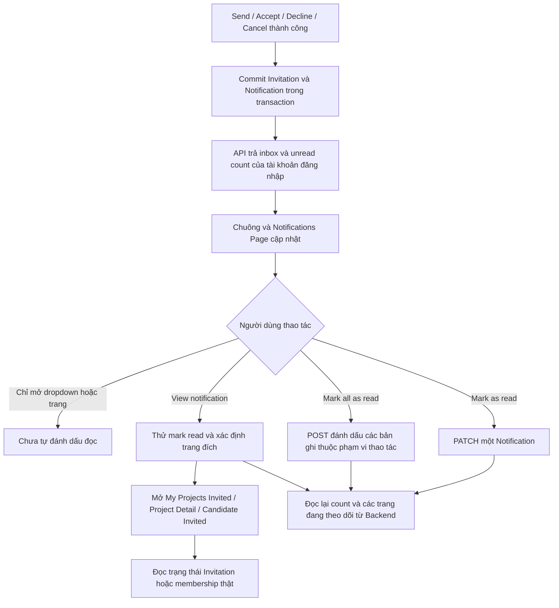

# In-app Notifications V1 — Flow và hướng dẫn thực hiện

Hướng dẫn tạo thông báo từ thao tác thật, quan sát chuông/Notifications Page, đánh dấu đọc và mở đúng dữ liệu Invitation. V1 sử dụng API và polling, không phải email hoặc WebSocket push.

## 1. Chuẩn bị

Chuẩn bị Account A là Leader và Account B là Member bằng hai browser profile độc lập. Hai tài khoản active, hoàn tất onboarding; B bật **Allow project leaders to discover me and send me team invitations** tại Profile → Edit profile → Save profile.

Project P của A phải Recruiting, còn hạn tuyển, còn team capacity. Position R thuộc P phải Open và còn slots. B chưa là thành viên, chưa có Pending Application/Invitation tại P và không trong cooldown Decline. Xem cách chuẩn bị và gửi lời mời tại [Teammate flow](TEAMMATE_FLOW.md).

Frontend/Backend cần dùng cùng database local/test đã có notifications migration. Chỉ dùng tài khoản và dữ liệu được phép thử nghiệm.

Trước mỗi bài thử, ghi lại unread count của người nhận, hoặc chọn **Mark all as read** để có mốc 0. Notification cũ vẫn ở All Updates sau thao tác này.

## 2. Sự kiện nào tạo Notification?

| Thao tác thành công | Type | Người nhận | Tiêu đề trên UI |
| --- | --- | --- | --- |
| A gửi Invitation | `invitation_received` | B, người được mời | Project invitation |
| B Accept | `invitation_accepted` | Leader hiện tại của Project | Invitation accepted |
| B Decline | `invitation_declined` | Leader hiện tại của Project | Invitation declined |
| A Cancel | `invitation_cancelled` | B, người được mời | Invitation cancelled |

Notification được ghi cùng transaction thay đổi Invitation. Backend có unique index cho `(invitation_id, type, recipient_user_id)` để một sự kiện của một Invitation không tạo nhiều bản ghi cho cùng người nhận.

Không tạo Notification cho Save, Shortlist, Skip, bật/tắt opt-in hoặc Invitation Expired. Application không nằm trong bốn loại Notification V1 này. Request thất bại không được hiểu là đã tạo sự kiện thành công.

## 3. Flow tổng quan

**Notification là lịch sử sự kiện.** Thông báo nhận Invitation vẫn giữ nội dung ban đầu dù Invitation sau đó đã Cancelled/Expired. Quyết định Accept/Decline phải dựa trên Invitation thật ở trang đích.

## 4. Bài thử chính: Nhận → Xem → Đọc → Accept

| Bước | Tài khoản | Thao tác | Kết quả cần thấy |
| ---: | --- | --- | --- |
| 1 | B | Mở **Notifications** ở sidebar, ghi lại unread count N. Nếu muốn mốc 0, chọn **Mark all as read** rồi đợi thành công. | Thấy **All Updates** và **Unread**. Chọn All Updates vẫn xem được lịch sử đã đọc. |
| 2 | A | Find Teammates → chọn P/R → tìm B → **Send Invitation to …**. Nhập message riêng như `QA notification - run 01` → **Confirm Send Invitation**. | Invitation Pending được tạo. |
| 3 | B | Giữ tab đang hiển thị, chờ polling khoảng 60 giây hoặc reload để lấy dữ liệu mới. | Có một Notification **Project invitation** cho lần gửi này. Nếu không có sự kiện/thao tác khác, unread từ N thành N+1. Độ trễ còn phụ thuộc mạng. |
| 4 | B | Mở chuông Notifications. | Dropdown hiển thị thông báo, thời gian, nút nhỏ **View notification** và **Mark as read** nếu chưa đọc. Chỉ mở dropdown chưa làm giảm unread. |
| 5 | B | Đóng dropdown, mở trang **Notifications** → **Unread**. | Thông báo vẫn còn Unread vì chưa đánh dấu đọc. Chỉ xem trang cũng không tự đọc toàn bộ inbox. |
| 6 | B | Bấm **View notification** của lời mời vừa gửi. | UI thử đánh dấu đọc và chuyển tới **My Projects → Invited**. Khi PATCH thành công, unread giảm một và trạng thái đọc được lưu. |
| 7 | B | Tìm lời mời đúng P/R/message → **Review invitation**. | Modal hiển thị Invitation thật. View notification chỉ điều hướng tới lịch sử; cần Review invitation để xem chi tiết/thực hiện phản hồi. |
| 8 | B | Bấm **Confirm Accept** khi lời mời còn Pending và đủ điều kiện. | Invitation Accepted; P xuất hiện trong My Projects → Active. |
| 9 | A | Reload Notifications hoặc chờ polling trong tab đang hiển thị. | Có Notification **Invitation accepted** mới cho lời mời đó. |
| 10 | A | Bấm **View notification** trên Accepted. | Khi tìm được Invitation trong lịch sử được cấp quyền, mở **Project Detail** của P. Đối chiếu thành viên B ở Project/Candidate Pipeline → Active. |
| 11 | B | Quay lại Notifications → All Updates rồi reload. | Thông báo Project invitation vẫn ở lịch sử và đã đọc. Không xuất hiện lại trong Unread khi read API đã thành công. |

Nếu thao tác đánh dấu đọc lỗi mạng, UI vẫn có thể điều hướng tới nội dung, đồng thời hiển thị banner trạng thái đọc chưa xác nhận và nút **Retry read update**. Không kết luận thông báo đã đọc chỉ vì đã chuyển trang.

## 5. Đường đi khi bấm View notification

| Type | Trang đích thông thường | Cách kiểm tra |
| --- | --- | --- |
| `invitation_received` | `/projects?tab=Invited&invitation_id=...` | Tìm đúng Invitation → Review invitation; xem trạng thái hiện tại. |
| `invitation_cancelled` | `/projects?tab=Invited&invitation_id=...` | Lời mời Cancelled, không có Accept cho lời mời đó. |
| `invitation_accepted` | `/project/{project_id}` | Kiểm tra Project và membership thật. |
| `invitation_declined` | `/candidates?tab=Invited&project_id=...&position_id=...` | Lịch sử hiển thị lời mời Declined đúng Project/Position. |

V1 Notification không mang `project_id` làm nguồn xác thực. Frontend tra `invitation_id` qua các Project/lịch sử mà người dùng có quyền xem. Nếu không tìm được context hoặc API lỗi, Accepted có thể về `/team`, Declined về `/candidates?tab=Invited`; khi context lookup lỗi, UI có thể nhắc chọn lại Project. Đây là fallback, không phải bằng chứng membership đã thay đổi.

Payload như tên Project, Position, actor dùng để trình bày; không dùng để cấp quyền hoặc tự tạo membership.

## 6. Các bài thử bổ sung

### 6.1. Mark as read một thông báo

1. Tạo Notification mới bằng Invitation mới cho Member đủ điều kiện.
2. Người nhận bấm **Mark as read** tại dropdown hoặc Notifications Page.
3. Kiểm tra count giảm một, unread dot biến mất; ở Unread, bản ghi không còn xuất hiện sau refresh dữ liệu.
4. Chuyển sang All Updates: thông báo vẫn còn, không bị xóa.
5. Reload: trạng thái đọc vẫn giữ. Qua API, `is_read=true`, `read_at` khác null.
6. Nếu gọi PATCH read lại cùng ID trong môi trường test, `read_at` ban đầu được giữ, count không giảm thêm.

### 6.2. Mark all as read

1. Dùng nhiều Invitation hợp lệ hoặc fixture local/test để tạo ít nhất hai Notification chưa đọc của cùng người nhận.
2. Bấm **Mark all as read** trên Notifications Page hoặc **Mark all read** ở dropdown.
3. Đợi thành công: các thông báo thuộc phạm vi thao tác được đọc; lịch sử All Updates còn nguyên.
4. Nếu không có sự kiện mới, unread count về 0; Unread hiện trạng thái đã đọc hết.
5. Gửi một Invitation mới sau đó: Notification mới phải Unread. Mark All có cutoff, không tự đánh dấu đọc mọi thông báo đến sau thao tác.

### 6.3. Decline độc lập

1. Dùng Member B2 đủ điều kiện và Invitation mới; không dùng Invitation đã Accepted ở mục 4.
2. B2 vào My Projects → Invited → Review invitation → **Confirm Decline**.
3. A nhận **Invitation declined**. View notification đưa tới Candidate Pipeline → Invited đúng P/R khi context tra được.
4. Kiểm tra trạng thái Declined; membership và filled_count không tăng.

### 6.4. Cancel trước khi người nhận mở thông báo ban đầu

1. A gửi Invitation mới cho B3; B3 chưa bấm View notification.
2. A vào Candidates → Invited → Review invitation → **Confirm Cancel Invitation**.
3. B3 nhận **Invitation cancelled**. Lịch sử của B3 có hai sự kiện cùng Invitation: Received và Cancelled, không phải hai bản sao của cùng một sự kiện.
4. B3 bấm View notification trên Received cũ → Review invitation.
5. Trạng thái thật phải Cancelled; không thể Accept. Membership/slots không tăng.

### 6.5. Hết hạn không tạo thông báo mới

1. Dùng fixture/test được phép có Invitation quá 168 giờ, hoặc chờ đến `expires_at`.
2. Reload lịch sử Invitation để thấy Expired.
3. Notification Received ban đầu vẫn là lịch sử; không có type/title Notification Expired mới.
4. View notification cũ không khôi phục quyền Accept lời mời hết hạn.

### 6.6. Hai phiên cùng tài khoản, tab ẩn và đổi tài khoản

1. Mở hai phiên độc lập cùng đăng nhập B. Đánh dấu đọc ở phiên thứ nhất.
2. Phiên thứ hai sẽ phản ánh trạng thái Backend sau reload/polling hoặc khi quay lại tab từ trạng thái ẩn; không yêu cầu cập nhật tức thời bằng WebSocket.
3. Chuyển tab thứ hai sang nền. Polling 60 giây không tiếp tục chạy trong tab ẩn; khi tab hiển thị lại, frontend refresh dữ liệu.
4. Logout B: polling dừng, cache inbox/count của B được loại khỏi phiên hiện tại.
5. Login tài khoản khác: chỉ thấy inbox/count của tài khoản mới. Response đang bay của B không được ghi đè lên inbox mới.

### 6.7. Phân trang 20 bản ghi

1. Chuẩn bị hơn 20 Notification thuộc cùng tài khoản bằng fixture local/test hoặc nhiều Invitation độc lập hợp lệ.
2. Mở All Updates: mỗi trang tối đa 20 bản ghi, mới nhất trước.
3. Bấm **Next notifications**, kiểm tra các bản ghi tiếp theo; bấm **Previous notifications** để quay lại.
4. Chuyển sang Unread: chỉ gồm bản ghi chưa đọc và bắt đầu từ trang 1.
5. Unread count là tổng inbox chưa đọc, không phải chỉ số lượng đang nằm trên trang hiện tại hoặc trong dropdown.

## 7. Kiểm tra nhanh bằng DevTools Network

Mở DevTools → Network → lọc `notifications`. Các request dùng JWT của tài khoản đăng nhập; không truyền recipient ID để đọc hộ người khác.

| Mục đích | Request | Dữ liệu cần kiểm tra trong `data` |
| --- | --- | --- |
| Danh sách | `GET /api/me/notifications?filter=all&page=1&page_size=20` | `items`, `pagination`; đối chiếu `notification_id`, `invitation_id`, `type`. |
| Chưa đọc | `GET /api/me/notifications?filter=unread&page=1&page_size=20` | Mọi item có `is_read=false`, `read_at=null`. |
| Count | `GET /api/me/notifications/unread-count` | `unread_count` của đúng tài khoản. |
| Đọc một | `PATCH /api/me/notifications/{notification_id}/read` | Notification có `is_read=true`, `read_at` khác null; không cần body. |
| Đọc tất cả | `POST /api/me/notifications/mark-all-read` | `updated_count`; không cần body. |

API yêu cầu active account và hoàn tất onboarding. ID thuộc người khác hoặc Notification không tồn tại không cho phép truy cập; UUID hợp lệ nhưng không thấy bản ghi trả 404. Với ID sai định dạng, routing/validation có thể trả lỗi khác 404 của bản ghi không tồn tại; không dùng ID sai định dạng để kết luận đã kiểm tra cross-user authorization.

## 8. Khi chưa thấy kết quả

| Hiện tượng | Cách kiểm tra |
| --- | --- |
| Chưa thấy Notification mới | Thao tác Invitation đã được xác nhận thành công chưa; đúng tài khoản người nhận chưa; tab có đang ẩn không. Reload hoặc quay lại tab để refresh. |
| Mở chuông nhưng count không giảm | Đúng hành vi. Chọn Mark as read hoặc View notification mới thử cập nhật read state. |
| Count khác số dòng trong dropdown | Count là tổng chưa đọc; dropdown chỉ là preview, trang danh sách phân trang 20 bản ghi. |
| View notification chuyển trang nhưng chưa đọc | Kiểm tra banner và Retry read update; chỉ xác nhận đọc sau khi API thành công. |
| API list/count lỗi | UI có Retry, có thể giữ count đã xác nhận gần nhất hoặc biểu diễn count chưa biết; không coi lỗi mạng là inbox rỗng. |
| Thông báo Received nhưng không Accept được | Review invitation thật: có thể Cancelled/Expired, opt-in OFF, Position/Project đầy hoặc điều kiện tài khoản đã thay đổi. |

## 9. Checklist ghi nhận kết quả

- [ ] Send/Accept/Decline/Cancel tạo đúng type, đúng người nhận và không trùng sự kiện.
- [ ] Chỉ mở chuông hoặc trang không tự đánh dấu đọc.
- [ ] View notification mở đúng nơi; read state chỉ được xác nhận sau API thành công.
- [ ] Mark as read, lặp lại read và Mark all as read không làm sai count/lịch sử.
- [ ] Reload giữ read state; phiên khác cập nhật sau refresh/polling.
- [ ] Notification cũ đọc trạng thái Invitation hiện tại, không cho Accept lời mời terminal.
- [ ] Expiry không tạo Notification mới.
- [ ] Phân trang, tab ẩn, logout và đổi tài khoản hoạt động đúng phạm vi dữ liệu.

Checklist này là hướng dẫn thực hiện, không phải tuyên bố các bài thử đã chạy trên môi trường của người đọc.

## 10. Điểm đối chiếu trong code

- [API Notifications](../../src/Tindy.Api/Controllers/MyNotificationsController.cs).
- [Read state, count và cutoff Mark All](../../src/Tindy.Infrastructure/Repositories/NotificationRepository.cs).
- [Tạo Notification trong Invitation transaction](../../src/Tindy.Infrastructure/Repositories/ProjectInvitationRepository.cs).
- [Frontend text và destination](../../../tindy-platform-frontend/src/services/notifications.service.ts).
- [Polling và session isolation](../../../tindy-platform-frontend/src/hooks/useNotificationState.ts).
- [Read và navigation](../../../tindy-platform-frontend/src/hooks/useNotificationNavigation.ts).
- [Teammate flow](TEAMMATE_FLOW.md).
