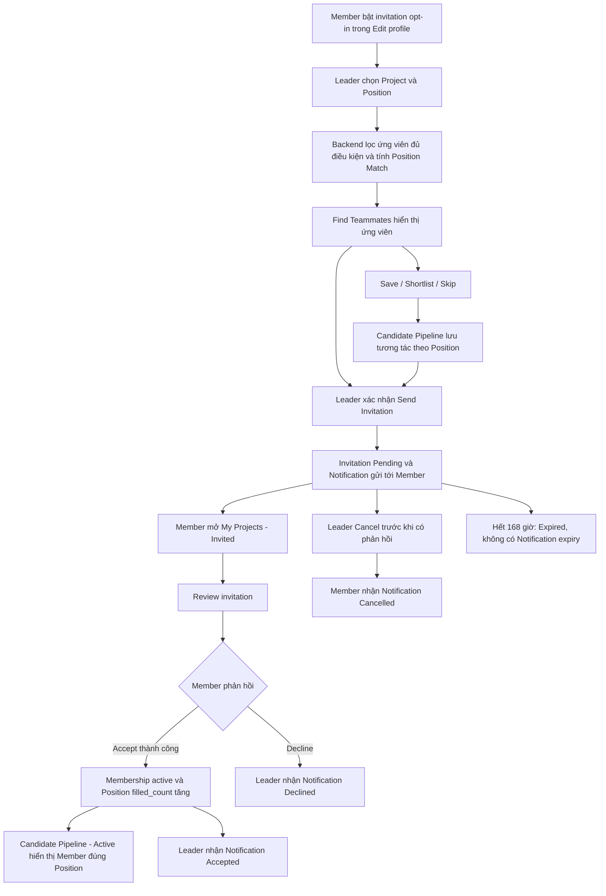

# Find Teammates V1 — Flow và hướng dẫn thực hiện

Tài liệu mô tả luồng Backend/Frontend hiện tại, từ Member bật nhận lời mời đến khi trở thành thành viên đúng Position. Các nhãn nút giữ nguyên tiếng Anh để dễ đối chiếu giao diện.

## 1. Chuẩn bị

Chạy Frontend và Backend kết nối cùng một database local/test đã có migrations của Find Teammates, invitation opt-in và notifications. Tham khảo [Database setup](DATABASE_SETUP.md) nếu cần chuẩn bị môi trường. Không dùng dữ liệu production cho các bài thử bên dưới.

| Dữ liệu | Điều kiện |
| --- | --- |
| Account A | Active, hoàn tất onboarding; là Leader thực tế của Project P. |
| Account B | Active, hoàn tất onboarding, có Profile; chưa là thành viên P, chưa có Application hoặc Invitation Pending tại P. |
| Project P | Đang Recruiting, chưa archive, chưa hết hạn tuyển dụng, còn team capacity. |
| Position R | Thuộc P, đang Open, `filled_count < required_count`. |
| Profile B | Có tên dễ nhận diện; nên điền preferred role, skills và availability để dễ xem điểm Match. |

Mở A bằng browser profile thứ nhất và B bằng browser profile thứ hai hoặc cửa sổ Incognito. Hai tab thường cùng browser profile dùng chung đăng nhập, không phù hợp để giữ hai tài khoản độc lập.

Ghi lại tên/ID của P, R, B và hai số ban đầu:

- Số thành viên active của P: `M`.
- `filled_count` của R: `F`.

## 2. Flow tổng quan

Save, Shortlist và Skip là tương tác riêng; chúng không tạo Invitation, Notification hoặc Membership.

## 3. Hướng dẫn chính: Opt-in OFF → ON → Invite → Accept

Thực hiện theo thứ tự, đổi đúng cửa sổ tài khoản ở từng bước.

| Bước | Tài khoản | Thao tác | Kết quả cần thấy |
| ---: | --- | --- | --- |
| 1 | B | Mở Profile → **Edit profile**. Bỏ chọn **Allow project leaders to discover me and send me team invitations** → **Save profile**. | Opt-in OFF được lưu; reload và mở Edit profile lại vẫn OFF. |
| 2 | A | Mở **Discover Projects** → **Find Teammates**, hoặc vào `/discover?mode=teammates`. Chọn P ở **Project you lead**, chọn R ở **Position** → **Refresh candidates**. | B không xuất hiện trong feed khi opt-in OFF; không thể gửi lời mời cho B từ feed này. Nếu không còn ứng viên khác, thấy **No eligible candidates**. |
| 3 | B | Vào Edit profile, bật lại checkbox trên → **Save profile**. | Reload vẫn thấy opt-in ON. |
| 4 | A | Tại Find Teammates, giữ P/R và bấm **Refresh candidates**. Bỏ các bộ lọc không phù hợp với B. | Khi B thỏa các điều kiện ở mục 6, card B xuất hiện. Có thể phải duyệt các card trước đó để tới B. |
| 5 | A | Xem card/hồ sơ B và phần Match Inspector hoặc giải thích Match. | Điểm là độ phù hợp của B với R, không phải điểm đánh giá vai trò Leader. Điểm thấp không tự cấm mời. |
| 6 | A | Bấm **Send Invitation to …** trên card B, hoặc **Send Invitation** trong Pipeline nếu nút có sẵn. | Modal **Send Project Invitation** hiển thị đúng B, P và R. Chỉ mở modal chưa gửi lời mời. |
| 7 | A | Nhập Optional message dễ nhận diện, ví dụ `QA teammate accept - run 01`. Bấm **Confirm Send Invitation** một lần. | Invitation có trạng thái Pending; xem được tại **Candidates → Invited** với P/R đã chọn. Team size vẫn M, filled_count vẫn F. |
| 8 | B | Reload hoặc chờ polling khi tab đang hiển thị, rồi mở chuông hoặc **Notifications**. | Có một **Project invitation** mới cho lần gửi này. Nếu trước đó có N thông báo chưa đọc và không có thao tác khác, unread tăng thành N+1. |
| 9 | B | Bấm nút **View notification**. | Thông báo được đánh dấu đọc khi API thành công; chuyển tới **My Projects → Invited**. Xem thêm [Notification flow](NOTIFICATION_FLOW.md). |
| 10 | B | Tìm lời mời theo P, R và message vừa nhập → **Review invitation**. | Modal hiển thị dữ liệu lời mời thật: người gửi, Project, Position, message, trạng thái và thời hạn. |
| 11 | B | Khi lời mời vẫn Pending và còn điều kiện, bấm **Confirm Accept**. | Invitation chuyển Accepted. Mở **My Projects → Active** thấy P. |
| 12 | A | Mở **Candidates**, chọn P/R → **Active** → **Refresh membership** nếu cần. | B xuất hiện trong Active của R. Team size thành M+1, filled_count của R thành F+1. Nếu đủ slots, Position chuyển Filled. |
| 13 | A | Chuyển sang Position khác rồi quay lại R; thử bỏ chọn Position tại Active. | B chỉ nằm dưới Position có cùng `position_id`. Khi bỏ lọc Position, thấy mọi thành viên active, có cả Leader. |
| 14 | A | Mở Notifications sau reload/polling. | Nhận **Invitation accepted** cho lời mời này. |
| 15 | A và B | Reload các trang tương ứng. | Invitation Accepted, membership và Position vẫn đúng. Trạng thái đọc thông báo đã lưu vẫn được giữ. |

**Phân biệt phạm vi:** `M` là số thành viên toàn Project, gồm Leader; `F` là slots đã dùng của riêng Position R. Project có 2 thành viên nhưng Active của một Position rỗng vẫn có thể đúng: Leader hoặc thành viên còn lại không được gán vào Position đó.

## 4. Thử Save, Shortlist, Skip và Reset

Thử trước khi gửi lời mời ở mục 3, hoặc dùng Member mới chưa có Pending Invitation/Application và chưa tham gia P.

| Thao tác | Cách thực hiện | Kết quả |
| --- | --- | --- |
| Save | Tại Find Teammates với P/R, bấm **Save** hoặc vuốt lên. | **Candidates → Saved**, chọn cùng P/R, thấy ứng viên. Reload vẫn giữ tương tác. |
| Shortlist | Refresh feed, tìm lại ứng viên đủ điều kiện, bấm **Shortlist** hoặc vuốt phải → **Confirm Shortlist**. | Thấy ứng viên tại **Shortlisted**. Đóng modal trước khi xác nhận không ghi Shortlist. |
| Skip | Tại feed, bấm **Skip** hoặc vuốt trái. | Ứng viên vào **Skipped**, bị loại khỏi feed của đúng Position đó. |
| Reset | Mở tab chứa ứng viên → **Reset interaction**. | Tương tác được xóa. Với Skip, refresh feed để ứng viên đủ điều kiện có thể xuất hiện lại. |
| Undo | Ngay trong lượt duyệt hiện tại, bấm **Undo** khi nút khả dụng. | Khôi phục tương tác trước đó của lần thao tác gần nhất; không hoàn tác Invitation hoặc Membership. |

Một ứng viên chỉ có **một action hiện tại** cho cùng Project/Position: Saved, Shortlisted hoặc Skipped. Đổi action sẽ thay action cũ. Cùng Member ở Position khác có lịch sử tương tác riêng.

## 5. Ý nghĩa các tab trong Candidate Pipeline

| Tab | Nguồn dữ liệu và cách quan sát |
| --- | --- |
| Interested | Application Pending do Member chủ động Apply vào Project. Không phải Shortlist hay lời mời. Từ ứng viên, chọn **Review application** để sang trang Applications và xử lý Accept/Reject. |
| Shortlisted | Tương tác `shortlisted` của đúng P/R. |
| Saved | Tương tác `saved` của đúng P/R. |
| Invited | Lịch sử Invitation của Project. Có bộ lọc status; chọn Position để lọc hoặc bỏ Position để xem tất cả. Bấm **Refresh invitations** khi cần. |
| Active | Membership thực tế, lọc bằng `position_id`; không dùng tên role để suy ra Position. |
| Skipped | Tương tác `skipped` của đúng P/R; có thể Reset. |

Các tab Shortlisted/Saved/Skipped cần chọn cả Project và Position. Khi chưa chọn, giao diện hiện card hướng dẫn với nút **Choose project** hoặc **Choose position** để focus dropdown. Active/Interested/Invited có thể xem theo toàn Project khi bỏ chọn Position. Tab Archived không được hiển thị.

Để thử Interested độc lập: dùng Member mới chưa có Pending Invitation tại P, mở Find Projects, vào P và Apply cho R. A mở Candidates → Interested với P/R, sau đó **Review application**. Nếu Leader xác nhận Accept Application thành công, kiểm tra membership/filled_count và Active tương tự. Các Notification V1 trong tài liệu này chỉ dành cho lifecycle Invitation, không suy ra có notification khi Apply.

## 6. Điều kiện xuất hiện và gửi/nhận lời mời

- Leader phải là chủ Project thực tế; chỉ có role hoặc tên hiển thị Leader là chưa đủ.
- Member phải active, chưa xóa, hoàn tất onboarding, có Profile và bật invitation opt-in.
- Không hiện chính Leader, thành viên active của P, người đang có Application Pending hoặc Invitation Pending còn hiệu lực trong P.
- Một Pending Invitation tại P chặn mời thêm cùng Member ở Position khác của P.
- Sau khi Decline, cùng Project phải chờ **168 giờ** từ lúc Decline mới được mời lại Member đó.
- Skip chỉ loại khỏi feed của Position tương ứng; không phải lệnh cấm gửi lời mời trực tiếp vĩnh viễn.
- Gửi mới cần Project còn tuyển dụng trước deadline, còn capacity và Position Open còn slots.
- Invitation hết hạn sau **168 giờ kể từ lúc tạo**. Pending không giữ slots.
- Accept kiểm tra lại opt-in, account, Project, Position, capacity, membership và Pending Application. Project phải còn Recruiting, chưa archive và người gửi ban đầu vẫn là Leader hiện tại. Lời mời chưa hết hạn vẫn có thể Accept sau deadline tuyển dụng.
- Tắt opt-in sau khi đã nhận lời mời không tự Cancel lời mời: B vẫn có thể Decline; cần bật lại opt-in trước khi Accept.

### Matching giữ nguyên rule-v1

| Tiêu chí | Trọng số gốc |
| --- | ---: |
| Required skills | 40% |
| Preferred role | 30% |
| Availability | 20% |
| Optional skills | 10% |

So khớp bằng catalog ID. Nhóm required/optional skills rỗng và availability Unknown được loại, trọng số còn lại chuẩn hóa về 100%. Thiếu preferred role vẫn tính factor 0. Không có ngưỡng điểm tối thiểu để mời; Experience, Difficulty và AI không tham gia tính điểm. Lịch sử tương tác không cung cấp điểm Match thì UI không tự tạo điểm.

## 7. Thử Decline, Cancel và Expired riêng

Dùng B2/B3 mới, hoặc Project độc lập; không dùng lại Invitation đã Accepted rồi thử chuyển sang Declined/Cancelled.

### Decline

1. B2 bật opt-in, đủ điều kiện; A gửi Invitation mới tới B2.
2. B2 mở My Projects → Invited → **Review invitation → Confirm Decline**.
3. Kiểm tra Invitation Declined, team size/filled_count không tăng và A nhận **Invitation declined**.
4. A thử tìm/mời lại B2 trong P ngay: bị giới hạn bởi cooldown 168 giờ, kể cả đổi Position.

### Cancel và click thông báo cũ

1. A gửi Invitation mới tới B3 và giữ Pending; B3 chưa bấm View notification.
2. A vào Candidates → Invited → **Review invitation → Confirm Cancel Invitation**.
3. Kiểm tra Invitation Cancelled; B3 nhận thêm **Invitation cancelled**. Team size/filled_count không tăng.
4. B3 bấm **View notification** trên thông báo nhận lời mời ban đầu.
5. Mở **Review invitation**: trạng thái thật là Cancelled, không còn thao tác Accept cho lời mời đó. Thông báo cũ vẫn là lịch sử của sự kiện gửi ban đầu.

### Expired

1. Dùng Invitation Pending được tạo quá 168 giờ trong fixture/test được phép, hoặc chờ đến `expires_at`.
2. Reload lịch sử: API trả trạng thái hiệu lực Expired; không Accept được.
3. Không tăng membership/filled_count và không phát sinh Notification Expired.

Không cần sửa đồng hồ máy hoặc sửa dữ liệu production để thử expiry.

## 8. Khi chưa thấy kết quả

| Hiện tượng | Kiểm tra |
| --- | --- |
| Không thấy B | Đúng P/R chưa; opt-in đã lưu chưa; có lọc role/skill/hours không phù hợp, Skip, Pending Application/Invitation, cooldown hoặc membership không. Refresh candidates sau khi thay đổi Profile. |
| Không gửi được | Quyền Leader thực tế, deadline, Project capacity, Position slots, trạng thái tài khoản và Pending Invitation toàn Project. |
| Gửi rồi không thấy Active | Pending chưa tạo membership. Phải có Accept thành công từ đúng người nhận. |
| Accept bị từ chối | Opt-in có bị tắt, lời mời có hết hạn/cancel, slots/capacity có bị người khác dùng, Project có đổi trạng thái/Leader không. Reload dữ liệu thật. |
| Có thành viên nhưng Active rỗng | Đang chọn Position khác hoặc membership chưa được gán vào Position đó. Bỏ lọc Position để đối chiếu toàn Project. |
| Lỗi mạng khi xác nhận | Nếu UI báo kết quả chưa xác nhận, dùng **Check invitation status**; không liên tục gửi request mới. |

## 9. Checklist ghi nhận kết quả

- [ ] Opt-in OFF ngăn discovery và lời mời mới; ON được lưu sau reload.
- [ ] Save/Shortlist/Skip/Reset đúng Project/Position, không tự tạo Invitation.
- [ ] Send tạo một Pending Invitation, không tăng team size/filled_count.
- [ ] Accept cập nhật membership đúng `position_id`, slots và Notification cho Leader.
- [ ] Decline/Cancel dùng Invitation riêng, không tạo membership.
- [ ] Notification cũ mở được lịch sử với trạng thái hiện tại.
- [ ] Reload giữ đúng Invitation, membership và read state.

Checklist này để người thực hiện tự đánh dấu, không phải báo cáo đã chạy kiểm thử.

## 10. Điểm đối chiếu trong code

- [Eligibility và capacity](../../src/Tindy.Infrastructure/Repositories/TeammateDiscoveryEligibility.cs).
- [Invitation lifecycle, membership và notification](../../src/Tindy.Infrastructure/Repositories/ProjectInvitationRepository.cs).
- [Matching rule-v1](../../src/Tindy.Application/Services/PositionMatchScorer.cs).
- [Find Teammates UI](../../../tindy-platform-frontend/src/pages/discovery/LiveTeammatesDiscoveryView.tsx).
- [Candidate Pipeline UI](../../../tindy-platform-frontend/src/pages/candidates/LiveCandidatesScreen.tsx).
- [Notification flow](NOTIFICATION_FLOW.md).
